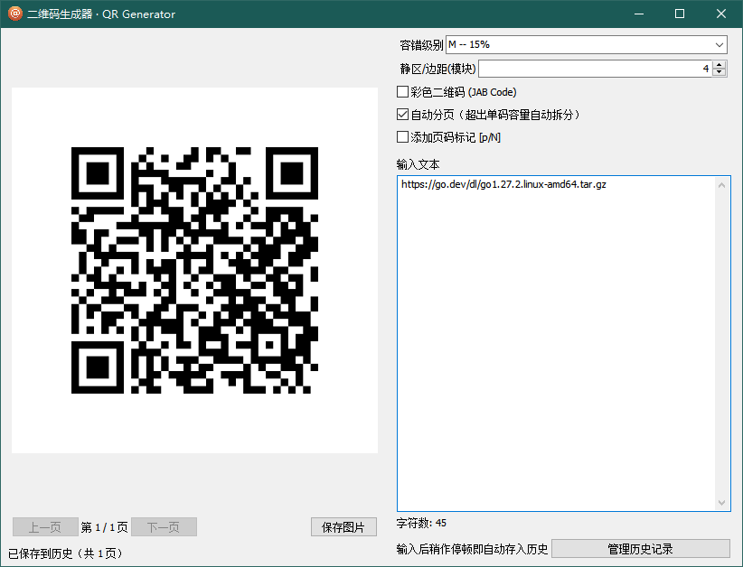
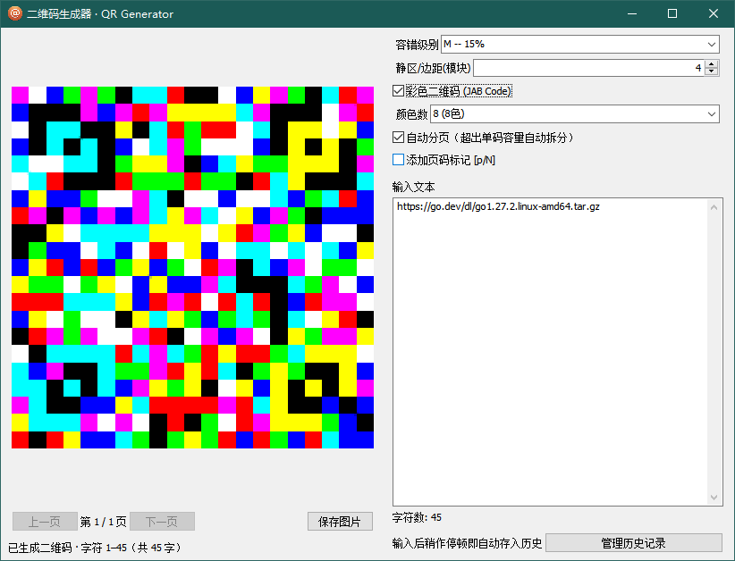

# 二维码生成器 · QR Code / JAB Code Generator

基于 Go 与 [lxn/walk](https://github.com/lxn/walk) 编写的 Windows 原生 GUI 二维码生成工具。支持普通黑白 QR Code 与彩色 JAB Code 两种标准，支持长文本自动分页、历史记录、系统托盘、保存图片等功能。

---

## 功能特性

- **黑白 QR Code**：支持标准 QR Code，可调整容错级别（L/M/Q/H）与静区边距。
- **彩色 JAB Code**：基于 [JAB Code](https://jabcode.org/)（Just Another Bar Code）标准，支持 4 色 / 8 色模式，适合需要更大信息密度的场景。
- **长文本自动分页**：当内容超过单码最大容量时，自动拆分为多页二维码；亦可关闭自动分页、按固定字符数分页。
- **历史记录**：输入后稍作停顿即自动保存到历史，支持打开历史窗口批量删除。
- **保存图片**：一键将当前页二维码保存为 PNG。
- **系统托盘**：关闭窗口(X)时最小化到托盘；托盘右键"退出"才会彻底退出程序。
- **静态链接无 CGO**：`CGO_ENABLED=0` 即可构建单文件可执行程序，便于分发。

## 运行截图

| 普通黑白 QR Code | 彩色 JAB Code（8 色） |
|---|---|
|  |  |

## 环境要求

- Windows 7/10/11（amd64）
- Go **1.27.0 或更高版本**（项目 `go.mod` 要求）
- 可选：`rsrc` 工具（用于将 `app.manifest` 与 `qrcode.ico` 嵌入 exe）

## 构建

### 一键打包（推荐）

使用 PowerShell 脚本自动完成资源嵌入、编译、打包：

```powershell
powershell -ExecutionPolicy Bypass -File build.ps1
```

构建产物：

- `dist/qrcode-gui.exe`：可执行文件（GUI 子系统，无控制台窗口）
- `dist/qrcode-gui.zip`：单文件 zip 包

支持参数：

```powershell
# 指定输出文件名
powershell -ExecutionPolicy Bypass -File build.ps1 -OutputName myqr.exe

# 只编译，不打包 zip
powershell -ExecutionPolicy Bypass -File build.ps1 -NoPackage
```

### 手动构建

```bash
# 1) 生成嵌入资源（图标 + 清单），生成 rsrc.syso
go install github.com/akavel/rsrc@latest
rsrc -manifest app.manifest -ico qrcode.ico -o rsrc.syso

# 2) 编译 Windows GUI exe（CGO 关闭、静态链接）
CGO_ENABLED=0 GOOS=windows GOARCH=amd64 go build -ldflags "-s -w -H windowsgui" -o qrcode-gui.exe .
```

> 注：`rsrc.syso` 已提交到仓库，若未修改图标/清单，可直接执行第 2 步。

## 项目结构

```
qrcode-gui/
├── main.go             # 程序入口：窗口、托盘、图标加载
├── ui.go               # walk 界面构建与交互逻辑
├── qr.go               # 二维码渲染、分页、保存（纯逻辑，零 GUI 依赖）
├── history.go          # 历史记录 JSON 持久化
├── jabcode_test.go     # JAB Code 渲染测试
├── qr_test.go          # 分页逻辑测试
├── history_test.go     # 历史删除工具函数测试
├── build.ps1           # 一键编译打包脚本
├── app.manifest        # Windows ComCtl32 v6 清单
├── qrcode.ico          # 程序图标
├── rsrc.syso           # 资源对象文件（由 rsrc 生成，go build 自动链接）
└── image/              # 截图
```

## 主要依赖

- [github.com/lxn/walk](https://github.com/lxn/walk) — Windows 原生 GUI
- [github.com/lxn/win](https://github.com/lxn/win) — Win32 API 封装
- [github.com/skip2/go-qrcode](https://github.com/skip2/go-qrcode) — 标准 QR Code 生成
- [github.com/srlehn/jabcode](https://github.com/srlehn/jabcode)（`jabenc` 子包）— JAB Code 彩色二维码编码

## 许可证

本项目采用 **GNU Lesser General Public License v3.0 (LGPL-3.0)** 开源，详见 [LICENSE](LICENSE) 文件。

第三方库许可证：

- `lxn/walk`、`lxn/win`：BSD 风格许可
- `skip2/go-qrcode`：MIT 许可
- `srlehn/jabcode`：其仓库内另行声明
